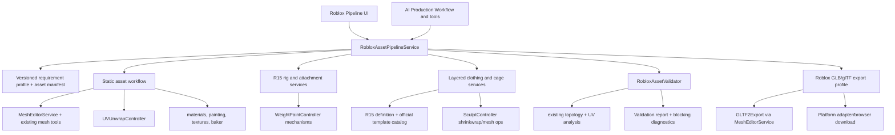
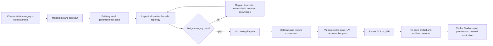

# Roblox Asset Production Pipeline — Technical Design

**Status:** Design only; no source code or configuration changed.
**Date:** 2026-11-25
**Repository baseline:** Mesh Editor source inspected in this checkout. The reference documents `MASTER_PROJECT_CONTEXT.md` and `ASSET_PRODUCTION_GUIDELINES.md` were supplied as PDFs; `TECHNICAL_ARCHITECTURE.md` and `ROBLOX_PRODUCTION_READINESS.md` are local Markdown documents. These describe the target and findings, not proof that proposed modules exist.

## 1. Goals and boundaries

Design a Roblox-specific production layer that reuses the editor's existing general mesh capabilities and adds validated Roblox asset profiles for:

- Static models: props, weapons, furniture, and environment objects.
- Rigid accessories, using accessory-category and attachment rules.
- Layered clothing/accessories with reference R15 rigs and official cages.
- AI-assisted creation, inspection, repair, validation, and export.
- Desktop and Android operation where browser/WebView capabilities allow.

The pipeline must not treat generic humanoid rigs, retopology cages, or bake cages as Roblox-compatible. It must distinguish a successful local geometry check from successful Roblox Studio import and marketplace approval. Roblox Studio remains the authoritative final import/fitting/submission environment unless a separately verified integration is added.

## 2. Repository baseline: integration inventory

| Existing capability | Actual source locations | Proposed use | Current Roblox status |
|---|---|---|---|
| Scene, transforms, mesh lifecycle, selection, undo/redo | `src/MeshEditorService.ts` (`recordAction()`, `undo()`, `redo()`, `mergeSelectedMeshes()`, `exportCurrentModel()`) | Keep as core editor and transaction/history provider. Add a Roblox asset session on top. | Generic features exist; Roblox profiles do not. |
| AI tool execution against live scene | `src/AIAgentService.ts` (`executeToolCall()` and request tool-call loop), `src/tools/ToolRegistry.ts` (`ToolRegistry`, `createDefaultToolRegistry()`), `src/tools/ToolExecutionContext.ts` | Reuse dispatch and scene context; add a small set of Roblox domain tools calling shared services. | General AI tooling exists. No Roblox validator/rig/cage tool. |
| Mesh creation and editing | `src/tools/builtin/`, including primitives, SDF, extrusions, boolean, voxel, CAD; `src/sculpting/SculptController.ts` | Use existing modeling commands for geometry generation, sculpting and repair operators. | Generic modeling only. |
| Optimization/topology inspection | `SculptController.retopologizeMesh()`, `shrinkwrapMesh()`, `generateQuadFlowCage()`, `analyzeTopology()` | Reuse generic decimation/shrinkwrap/analysis as operations; Roblox profile supplies limits and required checks. | Generic retopology cage is not an avatar cage. |
| UV editing and analysis | `src/uv/UVUnwrapController.ts` (`unwrapMesh()`, `normalizeTexelDensity()`, `packUVIslands()`, `analyzeUVs()`) | Reuse UV operators; add Roblox policy checks for valid UVs, cage correspondence and texture rules. | No Roblox validation. |
| PBR/material and texture authoring | `src/materials/`, `src/painting/TexturePaintController.ts`, `src/textures/AITextureGenerator.ts`, `src/baking/TextureBaker.ts` | Reuse the authoring UI and texture/bake operations. Add explicit Roblox material/texture conversion and validation. | General PBR; Studio result not verified. |
| Generic rig and weights | `src/rigging/WeightPaintController.ts` (`createAutoRig()`, `autoBindSkinWeights()`, `bindSingleMeshSkinWeights()`, `applyWeightBrushStroke()`, `poseActiveBone()`, `prepareMeshesForExport()`), `src/rigging/RiggingUIService.ts` | Reuse weight-brush mechanics, heatmap, undoable edits, pose preview, and glTF serializer preparation. Put a separate Roblox R15 definition/mapping layer in front. | Generic presets use non-R15 names and bound placement; not Roblox-ready. |
| GLB/glTF/OBJ/STL/Babylon export | `src/MeshEditorService.ts` (`exportCurrentModel()`, `exportToGLBBlob()`); `src/adapters/` | Reuse GLB and glTF serializers behind a Roblox export profile. OBJ stays available for static geometry fallback; exclude it for rigs/cages. | No FBX exporter; no Roblox export validation. |
| Browser/Electron adapters | `src/adapters/PlatformAdapter.ts`, `BrowserPlatformAdapter.ts`, `ElectronPlatformAdapter.ts`, `src/adapters/index.ts` | Extend platform boundary for export destination/capability reporting if needed. | Android currently resolves to browser adapter in WebView; no Capacitor-specific filesystem implementation. |
| Capacitor Android wrapper | `capacitor.config.ts`, `android/` | Run the shared web pipeline; use browser download/file-picker fallback. Optional future native file adapter, subject to actual device testing. | Wrapper exists; mobile performance and native asset flow are not verified. |

The factory comment in `ToolRegistry.ts` says 37 built-ins, while its current registration array has 53. Pipeline design should query the registry at runtime rather than hardcode a count.

## 3. Roblox policy source and versioning

Roblox rules should be stored as profile data, separate from mesh algorithms. A `RobloxRequirementProfile` identifies a target category, source URL, retrieved/reviewed date, and rule version. Do not bake marketplace limits into generic geometry controllers.

Use Creator Hub as the maintained source for current facts:

- [Importer](https://create.roblox.com/docs/studio/importer): Studio imports `.fbx`, `.gltf`/`.glb`, and `.obj`; FBX/glTF can carry hierarchies, PBR textures, cage meshes, rigs, avatar components, animation data, and vertex colors. The importer can detect cages and create Wrap instances when **Uses Cage** is enabled. GLB/glTF import hierarchy differs from FBX.
- [Layered accessory specifications](https://create.roblox.com/docs/avatar/layered-accessories/specifications): one render mesh, 4,000-triangle cap, watertight geometry, size limits by category, at least one attachment, R15 weighting with up to four influences, inner and outer cage requirements, and cage naming. Cage vertex and UV correspondence must be retained.
- [Layered accessory caging best practices](https://create.roblox.com/docs/avatar/layered-accessories/caging-best-practices): start from Roblox cage templates, do not alter cage UVs or vertex/edge/face counts, and adjust outer cage while maintaining fit/spacing.
- [Character body specifications](https://create.roblox.com/docs/avatar/character-bodies/specifications): standard R15 hierarchy and names; advanced optional bones; root influence restrictions; pose requirements.
- [Character body caging best practices](https://create.roblox.com/docs/avatar/character-bodies/caging-best-practices): body outer cages rely on fixed topology and UVs, with all 15 cage meshes and appropriate names.
- [UGC validation system](https://create.roblox.com/docs/marketplace/validation-system): examples of platform checks include zero-area cage UV triangles, cage UV/count mismatches, and cage fit conditions. The app may implement preflight checks but must not claim to reproduce Roblox's private/full validation.
- [Meshes and materials](https://create.roblox.com/docs/parts/meshes), [texture specifications](https://create.roblox.com/docs/art/modeling/texture-specifications): static mesh/material workflow and supported texture constraints.

Because requirements vary by asset category and may change, each profile records provenance and can be updated without changing generic modeling code. The initial implementation should only encode rules directly supported by published Creator Hub docs and clearly label category-specific marketplace requirements that still need Studio validation.

## 4. Proposed module structure

New modules are design names, not existing files. Keep them under a dedicated directory, e.g. `src/roblox/`:

```text
src/roblox/
  RobloxAssetPipelineService.ts       # facade/session state and orchestration
  domain/
    RobloxAssetTypes.ts               # static, rigid accessory, layered, R15 types
    RobloxRequirementProfile.ts       # versioned rules and provenance
    RobloxAssetManifest.ts            # target, units, source, parts, textures, checks
  validation/
    RobloxAssetValidator.ts           # ordered check runner + report
    GeometryChecks.ts                 # counts, bounds, degeneracy, manifold checks
    TransformChecks.ts                # units, orientation, origin/pivot policy
    UVMaterialChecks.ts               # UV validity, maps, material conversion
    RigChecks.ts                      # R15 hierarchy, index/weight constraints
    CageChecks.ts                     # template topology, UV correspondence, fit
  static/
    RobloxStaticAssetWorkflow.ts      # stage orchestration, calls existing services
  rigging/
    RobloxR15RigDefinition.ts         # reference schema and hierarchy validator
    RobloxBoneMapper.ts               # generic/custom to canonical R15 mapping
    RobloxR15RigService.ts            # create/import/template rig and skin operations
    RobloxAttachmentService.ts        # attachment markers and names
    RobloxPoseSuite.ts                # standard deformation test poses
  clothing/
    RobloxCageTemplateCatalog.ts      # versioned official template inventory
    RobloxCageTemplateLoader.ts       # import template; immutable source topology/UVs
    RobloxLayeredClothingService.ts   # garment fitting, cage copy/offset/edit controls
    RobloxCageCorrespondence.ts       # vertex/index/UV invariant checker
    RobloxAvatarFitPreview.ts         # body/cage preview and visual diagnostics
  export/
    RobloxGLTFExportProfile.ts        # package nodes, preserve names, call GLB/glTF exporter
    RobloxExportReadiness.ts          # pre/post export validation and manifest
  ai/
    RobloxProductionTools.ts          # AI tool wrappers around pipeline service
    RobloxProductionWorkflow.ts       # plan -> act -> inspect -> repair -> validate
  platform/
    RobloxFileDelivery.ts              # capability-aware file output wrapper
```

The modular boundaries are intentional:

- Domain definitions and requirement profiles contain Roblox conventions, no Babylon scene mutation.
- Validator consumes scene/manifest data and returns diagnostics; checks should be deterministic and independently testable.
- Workflow services orchestrate existing geometry/UV/material/rig controllers; they should not duplicate those algorithms.
- Export profile converts a validated asset into a glTF/GLB node set and invokes the existing exporter; it does not claim to generate Roblox runtime `Instance`s in the editor.
- UI and AI both call the same services, so they cannot silently implement different rule sets.
- Android/Electron file delivery is a platform concern and must not affect geometry correctness.

### Dependency diagram



## 5. Data model and pipeline session

Each production session should carry a serializable manifest linked to scene node IDs, rather than rely on display names alone:

```ts
// Proposed types, not current APIs.
type RobloxAssetKind = 'static' | 'rigid_accessory' | 'layered_accessory' | 'r15_body';
type CheckSeverity = 'error' | 'warning' | 'info';
interface RobloxAssetManifest {
  schemaVersion: number;
  kind: RobloxAssetKind;
  requirementProfileId: string;
  requirementProfileVersion: string;
  sceneNodeIds: string[];
  renderMeshIds: string[];
  cageNodeIds?: { inner?: string; outer?: string; bodyOuter?: string[] };
  rigId?: string;
  attachmentNodeIds?: string[];
  textureAssetIds?: string[];
  unitConvention: 'roblox_studs';
  targetOrientation: string; // populated from selected, documented profile/template
}
```

The manifest is editor metadata, not a Roblox upload format. Proposed shape should be reviewed against existing project serialization before implementation. Do not silently serialize unstable editor object references into the GLB.

## 6. Roblox Asset Validator design

### 6.1 Check pipeline

`RobloxAssetValidator.validate(sceneSnapshot, manifest, profile)` should run pure checks in phases and return a report with:

- `PASS`, `WARNING`, `FAIL`, or `NOT_TESTED` overall result.
- Each check ID, severity, measured value, target/profile value, mesh/node IDs, explanation, and safe repair action if available.
- `sourceProfileVersion`, app version, timestamp, asset kind, export format, and whether Studio import/fitting was actually tested.
- A clear distinction between **local preflight** and **Roblox Studio verified**.

A report is stale if geometry, UVs, materials, rig, attachments, cage vertices/UVs, or texture references change. Scene edit events should invalidate affected checks; final export is blocked by applicable errors and warnings require an explicit review/override stored in the report.

### 6.2 Required validation groups

| Group | Design checks | Existing component to reuse | New work |
|---|---|---|---|
| Category/policy | Selected asset kind has a known profile; requirements and citations are present; unsupported profile rules show `NOT_TESTED`. | None. | Profile repository, UI selection, provenance. |
| Geometry budget | Render triangle count per mesh and per category, relevant dimensional/bounds limits, disconnected/empty mesh, non-finite positions, zero-area/degenerate triangles. Make triangle budgets profile-driven (layered accessory published cap is 4k; static and other avatar categories need their own applicable rules). | `SculptController.analyzeTopology()`, Babylon vertex/index data. | Deterministic count/check code and category rules. |
| Mesh integrity | Edge incidence/boundary/non-manifold detection; closed/watertight checks for categories that require it; duplicate/zero-area faces; normals/winding diagnostics. Avoid claiming a mesh is watertight when only bounds/counts have been measured. | `analyzeTopology()` is a source of basic analysis. | Robust adjacency/topology validator; repair suggestions. |
| Scale, orientation, pivot | Bounds and dimensions in the active unit convention; origin, forward axis, grounding/attachment point, and Roblox Studio scene transform policy. | Existing transforms, bounding info, gizmos. | Explicit unit conversion/preset and target-specific checks. Do not assume existing scene units equal studs. |
| UV | Presence/range, finite values, zero-area UV triangles, overlap diagnostics where applicable, texture resolution and padding, cage UV equivalence by corresponding vertices. | `UVUnwrapController.analyzeUVs()`. | Strong UV checks; immutable template mapping; cage-specific comparisons. |
| Materials/textures | Supported map types, file availability, resolution, alpha/transparency/vertex color constraints for the selected class, PBR channel conversion profile, material count and per-mesh assignment. | Material/texture systems. | Roblox material adapter, asset packaging and explicit conversion report. |
| Rig/weights | Required canonical R15 hierarchy/names/parents, root and bind transforms, pose, bone indices in range, no prohibited root influences where body rules apply, max four influences, finite nonnegative normalized weights. | Weight arrays, `WeightPaintController` paint/pose UI. | R15 mapping and canonical validator. |
| Rigid accessory | Correct target body attachment point and naming/transform, one or more supported render meshes and valid attachment metadata. | Generic transform/scene nodes. | Accessory category profiles and attachment authoring. |
| Layered clothing | One render mesh as required; R15-bound weights; expected inner/outer cage nodes/names; exact template vertex/face topology and UV correspondence; outer cage covers garment while retaining valid cage relationship; applicable attachment. | Existing mesh operations and generic weight painter. | Official-template handling, cage editor, fit/cage validator. |
| Export readiness | Allowed format for selected kind, selected nodes present, serializer warnings/errors, texture dependencies included/referenced, deterministic node names, no transient overlays/helpers, no stale report. | `MeshEditorService.exportCurrentModel()` and export prep hooks. | Roblox node packaging profile and pre/postflight. |
| Studio verification | Record actual importer warnings/errors, Uses Cage result, imported hierarchy, WrapLayer/WrapTarget/Attachment creation and fitting check outcome. | Manual process only in initial phase. | Test fixtures/checklist; optional Studio plugin later only if a supported integration is demonstrated. |

The local app cannot promise complete UGC acceptance. Creator Hub documents platform validation such as cage UV errors and fit warnings; checks can be approximated locally, but Studio/UGC checks remain authoritative.

## 7. Static asset workflow



Sequence:

1. Select target class (static prop, weapon/held item, furniture, environment) and profile. User sets dimensions, placement, and desired detail level.
2. AI creates a modeling plan as structured steps, then calls existing geometry tools. It should use stable scene node IDs and record every action.
3. Inspect silhouette, bounds, topology, face normals, and triangle count. Use existing decimation/mesh tools for repair, then rerun checks; no destructive automatic repair without an undo entry.
4. Unwrap/pack through `UVUnwrapController`; assign materials/textures through existing systems. Apply only documented Roblox channel/texture conversions; report unsupported maps rather than silently dropping them.
5. Run validator and store diagnostics. Warnings are visible and not rewritten as passes.
6. Export GLB by default for a single packaged artifact; glTF may be offered when external texture/binary files are useful. Roblox supports glTF/GLB import, but verify the exact hierarchy/material outcome in Studio. Keep OBJ as a static geometry option only, with explicit limits on material/hierarchy preservation.
7. Re-open the exported artifact using the current loader path if supported and compare measured geometry, materials, textures, transforms, and node names with the pre-export manifest. Re-import validation proves file consistency, not Roblox acceptance.
8. Deliver model plus report and texture dependencies when not embedded. The UI labels “Roblox Studio verified” only after user records the Studio test result.

## 8. Roblox R15 rig system

### 8.1 R15 definition and mapping

Create `RobloxR15RigDefinition` from official reference hierarchy and naming; standard hierarchy includes `Root` and `HumanoidRootNode`, then `LowerTorso`, `UpperTorso`, head and left/right arm and leg chains. Exact parentage/transforms should be checked against the current Creator Hub specification and an official reference file before code ships. Advanced optional joints are a separate profile with explicit documented names/hierarchy; do not add them by guessing.

`RobloxBoneMapper` maps a source skeleton to the canonical names. It must return unmapped, ambiguous, duplicate, and extra bones as diagnostics, not silently rename or discard. Generic `WeightPaintController.createAutoRig()` remains a generic preset; it should not be relabeled Roblox. Initial Roblox setup should prefer an official R15 rig/reference template imported by the user or packaged only after its provenance/license is reviewed.

### 8.2 Weight workflows

Reuse the current weight editor's visualization, add/subtract/smooth/replace, symmetry, undo and pose functions. Add Roblox-specific weight checks and poses:

- Four or fewer influences for a vertex where the selected Roblox asset class requires it.
- Finite, nonnegative, normalized weights and valid joint indices.
- Standard body restrictions from current profile (including root influence rules where applicable).
- Independent pose suite for shoulders, elbows, wrists, hips, knees, ankles and body bend using selected neutral pose; preserve the bind pose after tests.
- Display deformed region, dropped zero-influence joints and warnings; never infer acceptable deformation from weight normalization alone.

### 8.3 Attachments

`RobloxAttachmentService` stores attachment transforms as scene nodes/metadata and emits names/mesh nodes that Roblox Importer can recognize where documented (e.g., `_Att` convention for certain caged imports). The UI selects accessory type and associated body part so the profile determines valid attachment names. Do not create fictional Roblox instance classes inside Babylon. Validate orientation and position against the intended attachment/reference rig, then verify result in Studio.

## 9. Layered clothing and cage workflow

### 9.1 Official cage templates

`RobloxCageTemplateCatalog` identifies each supported official body/accessory template, Creator Hub source, revision, target body parts, node names, vertex/index count, UV data, and an integrity hash. Initial plan: import only official reference files obtained from Roblox Creator Hub (or bundle after distribution/provenance review). Treat the base inner/outer cages and body cages as protected topology/UV assets.

`RobloxCageTemplateLoader` creates a working copy while retaining a canonical source. `RobloxCageCorrespondence` verifies vertex count, topology/face correspondence and UVs against template data. For each cage edit, prevent operations such as remesh, decimate, unwrap, weld, or automatic UV changes on protected cages; allow explicit controlled outer-cage vertex offsets while preserving indices/UVs. These controls are a design requirement, not a claim about current generic sculpt tools.

### 9.2 Garment fit and cages

1. Choose garment category and appropriate official reference body/cage.
2. Generate or import garment render mesh and fit it around inner cage.
3. Create inner cage from correct template; create outer cage from corresponding template and edit only its shape to encompass the garment while maintaining topology and UVs.
4. Check garment intersection/coverage relative to cage, cage spacing, degenerate/collapsed vertices and outlier distances. These local measurements are diagnostics and cannot substitute for Roblox wrap solver behavior.
5. Bind garment to canonical R15, validate weights, and test pose suite.
6. Emit names and mesh nodes required for Roblox importer cage recognition; Creator Hub describes importer conversion to `WrapLayer`/`WrapTarget` when “Uses Cage” is enabled. The app emits conforming interchange geometry; it does not create Roblox runtime Instances itself.
7. Export GLB/glTF with named nodes and verify cage selection/hierarchy using Studio Importer. Run manual Accessory Fitting Tool preview across supported avatar bodies and poses.

Roblox docs state that layered accessories need an inner and outer cage, up to four influences, one attachment, and cage vertex/UV correspondence. They also advise preserving template cage topology/UVs. The exact template and target accessory profile govern checks; do not reuse the generic quad-flow retopology cage or texture bake projection cage.

## 10. AI production workflow and tools

Expose the pipeline as one AI orchestrator plus narrowly scoped tools; all tools call the same services as UI:

1. **Reference analysis:** identify silhouette, category, visible features and unknown dimensions; use current image attachment/vision provider capability. Mark hidden geometry as assumptions. Current image-to-mesh is not a reliable deterministic pipeline and remains model/provider-dependent.
2. **Planning:** generate a structured plan with asset category/profile, nodes, operations, budgets, material/UV plan, validators and export format. Require confirmation for materially ambiguous target dimensions or accessory type when these change geometry.
3. **Model:** call existing `modeler_*` generation and editing functions. New domain tools: `roblox_get_profile`, `roblox_create_asset_session`, `roblox_create_r15_rig`, `roblox_add_attachment`, `roblox_load_cage_template`, `roblox_fit_layered_mesh`, `roblox_validate_asset`, `roblox_apply_safe_repair`, `roblox_export_asset` (names illustrative and proposed).
4. **Inspect:** return actual scene counts/bounds/topology/UV/material/rig/cage diagnostics; do not rely on the model's narrative assertion.
5. **Repair:** only apply a repair if its preconditions are satisfied; add one undoable action per operation; preserve original/high-poly mesh where possible. Rerun failed checks after changes.
6. **Validate:** produce machine-readable and human-readable report with blockers, warnings, profile version, and `NOT_TESTED` Studio gate.
7. **Export:** allowed only if required blocking checks pass or the user explicitly exports with warnings; embed report metadata separately or package a sidecar. Re-open/check file outputs.

Current `AIAgentService` groups successful model edits for undo, but `TECHNICAL_ARCHITECTURE.md` documents that a later tool/API failure can leave earlier scene modifications without rollback. The production orchestrator should use transaction/snapshot support or reliable grouped inverse actions and guarantee one-step undo/rollback for a failed stage before it is called production-safe. Every phase returns state and check evidence; LLM text is not evidence.

AI must not claim full UGC compliance, successful Avatar Setup, valid wrap fitting, or marketplace readiness solely because local checks pass.

## 11. Export architecture

Use the existing Babylon serializer through a Roblox-aware node-selection/metadata preparation layer:

- `RobloxGLTFExportProfile` creates a deterministic node set with intentional names, mesh hierarchy, attachment markers, R15 skeleton/skin attributes, and cage mesh nodes as appropriate.
- Keep render mesh, inner cage, outer cage and body cage roles explicit in the manifest and node naming. Validate the emitted glTF JSON/GLB contents after serialization: node names, primitive/mesh counts, joints, skin, weights, UV sets, material/texture references, transforms, buffer sizes, and expected cage nodes.
- Current `WeightPaintController.prepareMeshesForExport()` handles temporary weight-heatmap removal, linked transform nodes, and integer joint index buffers for Babylon glTF export. Retain this as serializer-specific preparation, but add export-profile checks around it.
- Supported current editor exports are GLB, glTF, OBJ, STL and Babylon scene serialization. No FBX exporter is present. Do not add FBX to a Roblox export menu until an exporter and its output are verified.
- Roblox Creator Hub supports FBX/glTF/OBJ import and documents GLB/glTF cage handling. GLB/glTF are the intended first formats because existing exporter supports them and Roblox importer supports them. This still requires real Studio import tests; names and semantics may differ between format paths.
- For glTF, include all `.bin`/image dependencies in a package or preserve working external references. For GLB, inspect embedded resources. Export package should include model, manifest/report, texture sources when external, profile version and a generated-file list.

## 12. Desktop and Android integration

The same TypeScript services should run in both environments; UI views may differ. No platform-specific geometry implementation is needed. Keep `RobloxAssetPipelineService` free of filesystem and DOM APIs.

- Browser/Android WebView: browser file picker and Blob download as current fallback. Provide explicit file names and a clear “download complete / locate file” message. Native Android Storage Access Framework integration is optional future work, not a prerequisite for geometry validation.
- Electron: extend the existing adapter only for native open/save destinations if desktop packaging requires it.
- Mobile UI should expose one guided stage at a time, large touch targets, collapsible diagnostics and focused viewport tools. Full weight painting/cage edits and detailed UV repair may remain more effective on desktop; report mobile limits honestly.
- Enforce configurable mobile budgets for texture resolution, mesh sizes and expensive operations based on actual profiling. Do not assert device-specific limits before measuring target Android devices.
- Heavy validation can be chunked/asynchronous or moved to a Worker after profiling; Babylon scene mutations stay on the main render context unless a worker-safe data boundary is implemented.

## 13. Test architecture

No tests are run by this design task. Existing tests include `tests/integration/gaming-pipeline-tools.test.ts` for generic rig/weight and GLB round-trip and `tests/integration/undo-redo-comprehensive.test.ts`; there is no Roblox Studio test harness in the inspected baseline.

Add tests in layers:

### Unit tests

- Profile rule fixtures by category and version; boundary tests for every numeric limit.
- R15 tree names/parents, duplicates, root transform, unmapped bones, optional joints.
- Weight normalization, invalid indices, max influence and root influence checks.
- Cage template hashes, vertex/index/topology/UV invariants; controlled outer cage edits preserve topology/UV.
- Geometry diagnostics: empty/nonfinite/degenerate, boundary/nonmanifold/watertight fixture meshes.
- UV zero-area and cage correspondence fixtures.
- Texture/material compatibility and missing-reference cases.

### Integration tests

- Build static asset from existing primitive/procedural tools, run checks, export GLB, reopen, compare manifest metrics and referenced resources.
- Import official reference R15 template, map bones, paint/edit weights, pose and reset, export GLB and assert expected hierarchy/skins/weights are serialized.
- Load official layered cage fixture; verify names and topology/UV preservation through garment fitting/outer cage edit/export.
- Inject a mid-stage AI tool failure; assert rollback restores scene and a single undo group handles successful workflow stages.
- Check stale report invalidation after geometry, UV, material, rig or cage edit.
- Test error/warning override policy and `NOT_TESTED` Studio gate.

### Roblox Studio manual acceptance suite

Maintain reproducible reference files and an operator checklist (or a separately verified Studio automation harness):

- Import GLB and glTF for static, R15 and layered accessory fixtures; record errors/warnings and hierarchy.
- For wearable fixtures, verify Importer recognizes cage nodes, produces expected Wrap instances when Uses Cage is enabled, and Accessory Fitting Tool fits/tests across multiple avatar bodies/poses.
- Verify materials/textures, orientation, scale, pivots/attachments and deformation in Studio.
- Re-run after Roblox profile/importer changes. Marketplace submission and moderation remain separate and are never implied by local pass.

### Device acceptance

- Desktop: mouse/keyboard, large scene and file round-trip.
- Android: supported devices/GPU/WebView versions, touch selection/painting, app background/resume, large file picker/download, memory/thermal behavior, and interrupted export recovery. Define measurable ceilings after collecting representative hardware data.

## 14. Acceptance criteria for calling a feature complete

| Feature | Acceptance criteria |
|---|---|
| Validator MVP | For chosen static profiles, reports measured bounds/triangles, invalid geometry and UV/material/texture issues with tests; identifies Roblox Studio step as untested until operator verifies. Rule sources/version are visible. |
| Static pipeline | User/AI can generate with existing tools, inspect, fix, produce a blocking/warning report, export GLB/glTF, reopen artifact, and reconcile report metrics. Studio manual fixture imports without unexpected errors for a documented tested asset. |
| R15 system | Uses reference-conformant hierarchy/names and transforms; mapping reports mismatches; weights comply with profile checks; pose suite demonstrates no known severe deformation; exported file is verified in Studio Importer. |
| Layered clothing | Starts from official template data; cage base topology and UVs remain unchanged as required; editable outer cage passes local invariants; export nodes/names recognized by Studio; WrapLayer/accessory fitting verified in Studio for reference bodies. |
| AI workflow | Model can inspect/plan/act/check/repair; each operation returns evidence and is undoable; injected failure rolls back its stage; final message reports exact checks and untested items. |
| Android | Basic stages and export work on declared devices; no claim of desktop parity for fine editing until touch/performance tests pass. |

## 15. Implementation roadmap (ranked by asset-quality impact)

| Priority | Phase | Deliverable | Why this order / exit gate |
|---|---|---|---|
| P0 | 0. Rules and fixtures | Versioned profiles for one static target and one layered accessory target; official reference rig/cage fixture provenance; test data and Studio checklist. | Prevents implementing inaccurate constraints or corrupting cage topology. No new UI needed to agree/verify rules. |
| P0 | 1. Validator foundation | Static geometry, triangle/bounds, transforms, UV, texture/material and export-readiness checks; report model and stale-check invalidation. | Catches defects for every asset before adding more modeling automation. Unit tests pass and an exported static fixture is reconciled. |
| P1 | 2. Static asset production vertical slice | Guided static workflow, safe repair loop using existing mesh/UV/material operations, GLB/glTF export profile, artifact reopen and Studio import checklist. | Delivers first end-to-end Roblox-useful output; verifies current export assumptions early. |
| P1 | 3. R15 rig definition and skin validation | Canonical hierarchy/reference loader, bone mapper, attachment authoring, weight validator and pose suite; integrate existing painter. | Makes skeletal structures conformant before complex clothing depends on them. Studio import fixture required. |
| P1 | 4. Layered cage template path | Protected template catalog/loader, cage correspondence checks, controlled outer-cage editing and garment fit diagnostics. | Cage integrity is a core determinant of layering quality; avoids generic cage false positives. Studio importer/fitting acceptance required. |
| P2 | 5. AI production orchestration | Domain tools, structured plans, stage-level transactions/rollback, inspect/repair/validate/export report. | Reliability and repeatability depend on the above deterministic services; AI must not invent conformance. |
| P2 | 6. Materials and production report polish | Roblox material conversion profiles, texture packaging, final scene inspection report and known limitations. | Improves visual fidelity and handoff after geometry/export pathway is stable. |
| P3 | 7. Mobile workflow refinement | Touch-first staged UI, file destination/help and performance budgets based on device measurements. | Improves Android usability without weakening the higher-impact geometry, rig and cage gates. |
| P3 | 8. Optional Studio automation | Explore supported Studio-side plugin/import automation only after manual workflow and official APIs are validated. | Avoids building on an unsupported bridge. Manual Studio remains valid fallback. |

## 16. Deferred / explicitly out of scope

- No Blender/Maya rewrite or replacement of Babylon.js mesh editors.
- No generic rigging rewrite; add a Roblox R15 profile and mapping using current weight-paint mechanisms.
- No new generic retopology cage to solve Roblox cages; official Roblox template cages have different semantics and preservation constraints.
- No claim of direct Marketplace upload, moderation approval or UGC compliance.
- No FBX exporter assumption; current code has no FBX export branch. GLB/glTF are the initial route, with Studio verification.
- No Android-only mesh algorithm or requirement to implement native file handling before static asset validation.
- No conversion of generic check results into a “Roblox approved” badge.
