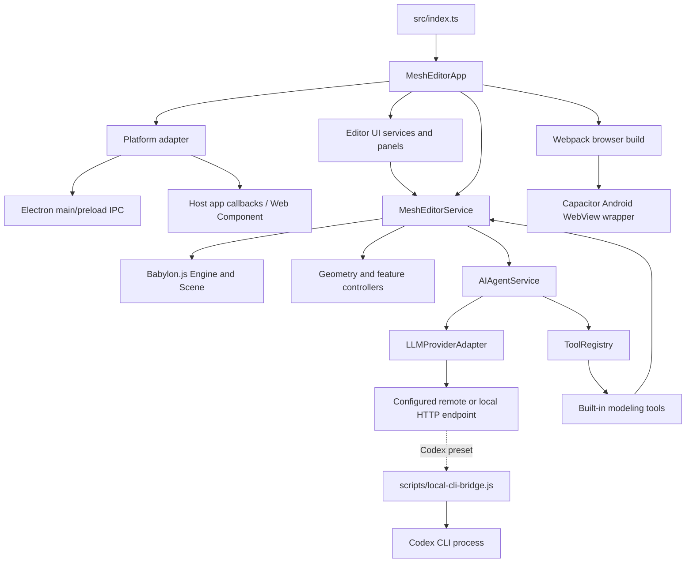

# Mesh Editor — Technical Architecture

**Audit basis:** repository contents inspected on 2026-11-25. This document describes code and configuration present in this checkout. A dependency being installed or an option appearing in a UI is not by itself treated as proof that a capability works; the evidence is the implementation and, where present, focused tests. “Planned” is used only when the repository itself identifies a plan. “Not Found” means no implementation was found in the inspected repository, not that the feature could never be added.

## 1. Repository structure

| Path | Purpose and responsibility | Status |
|---|---|---|
| `src/` | TypeScript application, rendering/service layer, editor panels, geometry, AI, import/export, platform adapters, and Web Component entry points. | Implemented |
| `src/tools/editor/` | Interactive editor tool classes and EJS panel templates; `toolViews.ts` is a generated/compiled view collection used by the UI. | Implemented |
| `src/tools/builtin/` | Function-call tools that operate on the live Babylon scene; registered by `ToolRegistry`. | Implemented |
| `src/services/` | UI-facing controllers for settings, layout, menus, files, outliner, inspector, export and AI. | Implemented |
| `src/geometry/`, `src/sdf/`, `src/minicad/`, `src/pathExtrusion/`, `src/voxel/` | Geometry builders and specialized mesh-generation/editing subsystems. | Implemented |
| `src/sculpting/`, `src/uv/`, `src/painting/`, `src/baking/`, `src/rigging/`, `src/heightmap/`, `src/decals/`, `src/splatting/`, `src/textures/` | Specialized controllers and UI for geometry, UV, textures, baking, rigging, terrain, decals, splats and image generation. | Implemented |
| `src/adapters/` | Browser, Electron and embedding-host platform boundary. | Implemented |
| `src/web-component/` | `<mesh-editor>` custom element and host event/attribute integration. | Implemented |
| `src/mesheditor.ejs`, `src/mesheditor.css`, `src/template.ts`, `src/styles.ts` | Main application markup/styles and generated template/style modules. Build scripts synchronize source templates and styles. | Implemented |
| `src/assets/`, `src/promptImages/` | Fonts, textures and prompt/reference images bundled with the app. | Implemented |
| `skills/`, `src/builtInSkills.ts` | Markdown guidance used as contextual instructions by the AI agent; built-in skill definitions are available in source. | Implemented |
| `scripts/` | Build preparation/synchronization scripts and local AI bridge servers. | Implemented |
| `electron/` | Electron main process and restricted preload bridge. | Implemented |
| `android/`, `capacitor.config.ts` | Capacitor Android wrapper project and its WebView/build configuration. | Implemented (Android) |
| `docs/` | Static website, examples, screenshots, and sample 3D assets. | Implemented |
| `examples/` | Example projects, including the Web Component showcase. | Implemented |
| `tests/integration/` | Vitest suites for services and feature areas. | Implemented |
| `tests/e2e/` | Playwright browser end-to-end suite. | Implemented |
| `build/` | App icons and document/file-association icons used by packaging. | Implemented |
| `package.json`, `package-lock.json` | Package metadata, declared dependencies, scripts, and lockfile-resolved dependency versions. | Implemented |
| `webpack*.js`, `tsconfig*.json`, `vitest.config.ts`, `playwright.config.ts` | Application/library build, type-check, and test configuration. | Implemented |

The package metadata identifies version `1.7.0`; its `repository` field points to `https://github.com/peer2p/mesheditor.git`. Git origin and package metadata may differ for forks and are not the runtime architecture.

## 2. Overall application architecture

The application is a browser-first TypeScript editor. Webpack builds `src/index.ts` and the EJS/CSS UI into `dist/`. `MeshEditorApp` owns UI composition, platform adapter selection and event-to-view updates. It creates a `MeshEditorService`, which owns the Babylon `Engine`, `Scene`, camera, lights, mesh state, history and feature controllers. Editor panels call that service or its specialized controllers. The optional AI agent calls a configured HTTP endpoint, receives function/tool requests, dispatches them through a registry and applies them to that same in-memory scene.

**Status:** Implemented. `src/index.ts`, `src/MeshEditorApp.ts`, `src/MeshEditorService.ts`, `src/AIAgentService.ts`, and `src/tools/ToolRegistry.ts` are the primary orchestration points.

## 3. Frameworks, libraries and versions

Versions below are the resolved versions in `package-lock.json` for this checkout. `package.json` uses a mixture of ranges and exact pins, so the lockfile is the reproducible install snapshot.

| Package | Resolved version | Actual role in repository |
|---|---:|---|
| `@babylonjs/core` | 9.29.0 | WebGL rendering, scene graph, mesh/material APIs, cameras, lights, gizmos and geometry. |
| `@babylonjs/loaders` | 9.29.0 | Babylon scene/model loader registrations used for supported formats. |
| `@babylonjs/materials` | 9.29.0 | Grid/terrain and other Babylon material implementations. |
| `@babylonjs/serializers` | 9.29.0 | glTF/GLB, OBJ, STL and Babylon scene serialization used by export paths. |
| `@capacitor/core`, `@capacitor/android`, `@capacitor/cli` | 8.6.2 | Web app to Android wrapper/sync/build tooling. |
| `three` | 0.187.0 | Isolated COLLADA conversion path using Three.js `ColladaLoader` and `GLTFExporter`; Babylon remains the editor renderer. |
| `earcut` | 2.2.4 | Polygon triangulation dependency used by polygon/shape geometry operations. |
| `dat.gui` | 0.7.9 | Numeric/property controls in legacy and inspector panels. |
| `lucide` | 1.76.0 | UI icon library referenced by the editor template. |
| `marked` | 18.1.2 | Markdown rendering for assistant/help output. |
| `tippy.js` | 6.3.7 | Tooltip UI. |
| `typescript` | 6.0.3 | Application language/compiler. `strict` is `false` in `tsconfig.json`. |
| `webpack`, `webpack-cli`, `webpack-dev-server` | 5.112.2, 7.2.2, 6.0.0 | Browser and library bundling/development server. |
| `ts-loader`, `html-webpack-plugin`, `copy-webpack-plugin` | 9.6.2, 5.6.4, 13.0.1 | TypeScript compilation and HTML/static asset packaging. |
| `electron`, `electron-builder` | 45.1.0, 26.18.0 | Desktop runtime and macOS/Windows/Linux packaging. |
| `vitest`, `jsdom` | 5.0.5, 30.1.3 | Integration/unit test runner and DOM test environment. |
| `@playwright/test` | 1.64.1 | Browser end-to-end test runner. |

Other development typings are `@types/dat.gui` 0.7.13, `@types/node` 26.2.0 and `@types/three` 0.187.0. The lockfile is authoritative for transitive dependencies; this document does not infer that every transitive package is used directly by application code.

**Status:** Implemented. Build commands and package declarations are in `package.json`; Webpack configs are `webpack.config.js`, `webpack.prod.config.js` and `webpack.lib.config.js`.

## 4. Babylon.js rendering and scene

### Renderer and scene initialization

| Component | Location | Responsibility / relationship | Status |
|---|---|---|---|
| Engine/scene bootstrap | `src/MeshEditorService.ts` (`initBabylon`) | Creates `Engine(canvas, true, { preserveDrawingBuffer: true, stencil: true, antialias: true })` unless a host supplies an Engine; creates one `Scene`, starts `runRenderLoop`, and resizes on window and `ResizeObserver` events. | Implemented |
| Camera | `src/MeshEditorService.ts` | Creates `UniversalCamera` at `(0, 2.5, -6)`, targets `(0,1,0)`, supports keyboard movement and desktop right-button camera control. Custom pointer logic implements mobile orbit/pinch/pan. | Implemented |
| Lighting/environment | `src/MeshEditorService.ts`, `src/utils/proceduralEnvironment.ts` | Hemispheric ambient and directional sun lights; attempts procedural environment texture/IBL when a GPU context exists. | Implemented; environment setup is guarded and may be skipped in headless contexts |
| Grid/highlighting | `src/MeshEditorService.ts` | `GridMaterial` ground helper and `HighlightLayer` for selection/facet feedback. Helpers are tagged/filtered from ordinary model operations. | Implemented |
| CSG2 initialization | `src/MeshEditorService.ts` | Calls Babylon CSG2 asynchronous WebAssembly initialization; records readiness and warns on failure. Boolean operations depend on the runtime initialization. | Partially Implemented (async initialization can fail/defer) |
| Render backend fallback | `src/MeshEditorService.ts` | Uses Babylon `Engine`; no application-level software renderer is implemented. | Implemented (GPU/WebGL path); alternative backend Not Found |

The scene is in-memory and uses Babylon `Mesh`, `TransformNode`, `Material`, `AnimationGroup`, and related types. `MeshEditorService` maintains `importedMeshes`, selection state, groups, camera/environment settings, animations and editor helper nodes. `SceneOutlinerService` and `InspectorGuiService` reflect that state in the UI. `MeshEditorServiceEvents` callbacks notify the app after selection, scene edits, history changes, status changes, exports and related actions.

## 5. Mesh/object management and editing capabilities

The ordinary editor panel classes are instantiated by `createBuiltinEditorTools()` in `src/tools/editor/index.ts`. Their EJS markup is in the matching `src/tools/editor/*.ejs` files; behavior is delegated to `MeshEditorApp`, `MeshEditorService` and feature controllers.

### Interactive panels

| Capability / panel | Main implementation locations | Status |
|---|---|---|
| Scene outliner, select, transform gizmos, mesh properties | `src/tools/editor/OutlinerEditorTool.ts`, `MeshPropertiesEditorTool.ts`; `src/services/SceneOutlinerService.ts`; `src/MeshEditorService.ts` | Implemented |
| Primitive creation, selection/place mode, clone/duplicate, copy/paste, delete, group/ungroup, merge/separate, pivot/focus | `src/MeshEditorService.ts`; `src/tools/editor/CreatePrimitiveEditorTool.ts` | Implemented |
| Facet/vertex selection and editing, extrusion/inset, arc, knife/loop cut, bevel, solidify, array, cut-through, relax, subdivide, normals, delete face, per-face UV/material | `src/MeshEditorService.ts`, `src/geometry/facetSurfaceUtils.ts`, `src/geometry/bevelModifier.ts`, `src/tools/editor/FacetEditorTool.ts` | Implemented |
| CSG boolean operations | `src/MeshEditorService.ts`, `src/tools/editor/CSGEditorTool.ts` | Implemented; requires successful CSG2 runtime initialization |
| Sculpt and retopology | `src/sculpting/SculptController.ts`, `src/sculpting/SculptUIService.ts`, `src/tools/editor/SculptEditorTool.ts`, related builtin tools | Implemented |
| Voxel painting and voxel-to-mesh | `src/voxel/`, `src/tools/editor/VoxelPainterEditorTool.ts`, builtin voxel tools | Implemented |
| Path drawing/extrusion | `src/pathExtrusion/`, `src/tools/editor/PathExtrusionEditorTool.ts` | Implemented |
| Mini CAD | `src/minicad/`, `src/tools/editor/MiniCadEditorTool.ts` | Implemented |
| UV editor/unwrapping | `src/uv/`, `src/tools/editor/UVUnwrapEditorTool.ts` | Implemented |
| Material inspector and textures | `src/services/InspectorGuiService.ts`, `src/tools/editor/MaterialEditorTool.ts` | Implemented |
| Texture paint/layers/stencils | `src/painting/`, `src/tools/editor/TexturePaintEditorTool.ts` | Implemented |
| Texture baking and optimization | `src/baking/`, `src/tools/editor/BakingEditorTool.ts`, `TextureOptimizerEditorTool.ts` | Implemented |
| Heightmap terrain and mix painting | `src/heightmap/`, `src/tools/editor/HeightmapEditorTool.ts` | Implemented |
| Decals | `src/decals/`, `src/tools/editor/DecalEditorTool.ts` | Implemented |
| Text meshes | `src/textMesh/`, `src/tools/editor/TextMeshEditorTool.ts` | Implemented |
| Rigging/weight painting | `src/rigging/`, `src/tools/editor/RiggingEditorTool.ts` | Implemented |
| Animation group playback | `src/tools/editor/AnimationPlayerEditorTool.ts`, animation methods in `MeshEditorService.ts` | Implemented for loaded Babylon animation groups; full authoring UI Not Found |
| Gaussian splats | `src/splatting/`, `src/tools/editor/GaussianSplatEditorTool.ts` | Implemented |
| AI agent and AI texture generation | `src/AIAgentService.ts`, `src/textures/`, matching editor panels | Partially Implemented: editor/client paths exist, but generation requires a configured external endpoint/provider; no inference model is bundled. |
| Model compression | `src/compression/`, `src/tools/editor/CompressModelEditorTool.ts` | Implemented for supported export formats and installed codec path; see format-specific caveat below |

### Registered AI modeling tools

`src/tools/ToolRegistry.ts` instantiates concrete tools and creates OpenAI-style function schemas. The current registry contains these 53 tool instances (the source comment describing the factory as “37” is stale):

- **Scene, planning, geometry:** `GetSceneInfoTool`, `PlanModelTool`, `CreatePrimitiveTool`, `CreateRoundedBoxTool`, `CreateSdfMeshTool`, `ExtrudePolygonTool`, `ExtrudeShapeTool`, `CreateLatheTool`, `CreateTubeTool`, `CreateWallTool`, `CreateArchTool`, `CreateColumnTool`, `CreateMoldingTool`, `CreateStairsTool`, `CreateRoofTool`, `SpawnBaseMeshTool`.
- **Mesh operations:** `BooleanOperationTool`, `TransformMeshTool`, `CloneArrayTool`, `MergeMeshesTool`, `SeparateMeshTool`, `DeleteMeshTool`, `SolidifyMeshTool`, `SubdivideMeshTool`, `SubDSmoothTool`, `FacetExtrudeTool`, `FacetInsetTool`, `FacetArcTool`, `FacetCutThroughTool`, `SculptMeshTool`, `RetopologizeMeshTool`, `CheckZFightingTool`.
- **Voxel, texture, UV and material:** `BuildVoxelMeshTool`, `VoxelPainterTool`, `CreateMaterialTool`, `ApplyMaterialTool`, `AutoUVMappingTool`, `UVUnwrapTool`, `BakeTexturesTool`, `GenerateTextureTool`, `PaintTextureTool`, `DecalTool`.
- **Other scene representations and workflows:** `GenerateNeuralMeshTool`, `RigWeightTool`, `CreateTextMeshTool`, `CreateHeightmapTool`, `ManageGaussianSplatTool`, `MeshToSplatsTool`, `CadCreatePartTool`, `CadModifyPartTool`, `CadAlignAndMeasureTool`, `CadInspectAndCutListTool`, `ExecuteBabylonCodeTool`.

Custom tools can be registered through `AIAgentService.registerTool()` and plugins can register editor UI/menu items through `src/plugin.ts` and `PluginManager`. The presence of a neural generation tool does not bundle or run a neural model; it calls a configured provider.

## 6. Procedural geometry and mesh generation

| Component | Location | Technology/function | Status |
|---|---|---|---|
| Babylon primitive geometry | `src/MeshEditorService.ts`, `CreatePrimitiveTool.ts` | Babylon `MeshBuilder` for boxes, spheres, cylinders, cones, capsules, torus/knot, planes, discs, ground and polyhedra. | Implemented |
| Architectural builders | `src/geometry/architecture.ts` and `CreateWall/Arch/Column/Molding/Stairs/RoofTool.ts` | Custom wall openings, arch, column, molding profiles, stairs, roof and merged mesh construction. | Implemented |
| SDF modeling | `src/sdf/sdfPrimitives.ts`, `src/sdf/surfaceNets.ts`, `CreateSdfMeshTool.ts` | Signed-distance primitives, smooth union/subtract/intersect operations and surface nets mesh extraction. | Implemented |
| Organic geometry | `src/geometry/organicGeometry.ts`, `src/geometry/roundedBox.ts` | Custom rounded/organic mesh support. | Implemented |
| Extrusion/lathe/tube/polygon | `src/pathExtrusion/`, `src/MeshEditorService.ts`, builtin geometry tools | Paths/profiles are turned into Babylon meshes. | Implemented |
| Mini CAD | `src/minicad/MiniCadGeometry.ts`, `MiniCadController.ts`, `MiniCadTools.ts` | Parameterized CAD-style part builders/modifications and align/measurement/cut-list tools. | Implemented |
| Voxel meshing | `src/voxel/CustomVoxelMesher.ts`, `TextureAtlasManager.ts` | Voxel block state, palette/atlas system and custom mesh generation. | Implemented |
| Neural 3D generation | `src/Neural3DGeneratorService.ts`, `GenerateNeuralMeshTool.ts` | HTTP adapters for configured TRELLIS, Hunyuan3D and Hi3D provider protocols (local REST/Gradio/oMLX and selected hosted APIs). | Partially Implemented (client integration exists; model availability, credentials, service execution and response compatibility are external) |
| Gaussian splat conversion/presets | `src/splatting/GaussianSplatController.ts` | Imports/exports splat data, converts triangle meshes to splats, generates presets and applies transforms/cleanup. | Implemented |

## 7. Materials, PBR, textures and UV

`MeshEditorService` uses Babylon `PBRMaterial` and `StandardMaterial`. The editor supports color, roughness/metallic parameters, transparency/alpha settings, two-sided materials, base/diffuse and emissive textures, metallic/roughness textures, bump/normal textures, parallax settings and material assignment to meshes/facets. `src/utils/proceduralEnvironment.ts` supplies a generated environment map when runtime graphics support is available.

| Component | Location | Responsibility | Status |
|---|---|---|---|
| Material creation and inspection | `src/MeshEditorService.ts`, `src/services/InspectorGuiService.ts`, `MaterialEditorTool.ts` | Create/edit materials and texture slots; supports both PBR and standard materials in applicable paths. | Implemented |
| UV projections | `src/MeshEditorService.ts`, `src/geometry/facetSurfaceUtils.ts` | Planar, cylindrical and triplanar mapping; facet UV rectangle/corner operations. | Implemented |
| Smart unwrap and packing | `src/uv/UVUnwrapController.ts` | Seam marking, angle/primitive projections, chart/island construction, packing, texel density analysis and preview. This code implements the algorithms locally; no separate xatlas dependency is declared. | Implemented |
| Texture painting | `src/painting/TexturePaintController.ts`, `TexturePaintUI.ts` | 2D/3D paint canvas, albedo/roughness/metallic/emissive channels, layers, stencils and undoable strokes. | Implemented |
| Texture utilities | `src/tools/textureUtils.ts` | Procedural image/normal map generation and PBR buffer/channel processing, including image transformations and seamless tiling helpers. | Implemented |
| Texture baking | `src/baking/TextureBaker.ts` | Bakes supported material/map data from scene geometry. | Implemented |
| AI texture image generation | `src/textures/AITextureGenerator.ts`, `ExternalImageGeneratorService.ts` | Calls external image-generation endpoints/providers, then consumes results as textures. | Partially Implemented (remote provider and network required; no local diffusion model bundled) |
| Embedded texture manager | `src/services/EmbeddedTextureUIService.ts`, service methods in `MeshEditorService.ts` | Lists, applies, replaces and removes embedded scene textures. | Implemented |
| Texture atlases | `src/voxel/TextureAtlasManager.ts` and voxel/facet UI | Creates/manages atlas frames and applies a frame/material to supported targets. | Implemented |

## 8. Import, export and project files

`src/MeshEditorService.ts` implements `loadFiles`, `importFiles`, URL variants, `exportCurrentModel`, `exportToGLBBlob`, and compression export. `src/services/InputAndFileService.ts` handles browser inputs/drop events. `src/services/ExportAndScreenshotService.ts` handles the export and screenshot dialogs. Platform adapters may replace browser file selection/download behavior.

| Format/capability | Evidence in this repository | Status and qualifications |
|---|---|---|
| GLB/glTF import and export | Babylon loaders and serializers; `MeshEditorService.ts` | Implemented. glTF may use companion resources/files; Electron resolves companions on native open. |
| OBJ and STL import/export | Babylon loader registration and serializer calls | Implemented through Babylon paths. |
| COLLADA `.dae` import | `src/loaders/ColladaConverter.ts` | Implemented by parsing with Three.js and exporting a temporary GLB before Babylon import. Companion textures are resolved when provided and warnings/fallback texture are used when missing. Export to DAE is Not Found. |
| Babylon `.babylon` scene | `SceneSerializer.Serialize` and Babylon loader | Implemented; used for scene/project-style save and reload. |
| Gaussian splat `.splat` and PLY splat data | `src/splatting/GaussianSplatController.ts` | Implemented in the dedicated Gaussian Splat panel; generic mesh PLY handling depends on Babylon loader. |
| FBX | Extension appears in input allowlist; no in-repository FBX converter found | Not Verified. The extension allowlist alone does not establish a working loader. |
| SPZ/SOG | Dedicated Gaussian Splat controller accepts these extensions and delegates loading to Babylon's Gaussian splat mesh loader/path | Partially Implemented; actual support is dependent on Babylon loader/runtime compatibility and should be validated against target files. |
| Screenshots | `ExportAndScreenshotService.ts`, `src/utils/zipBuilder.ts` | Implemented for current view and multi-direction capture; multi-image output can be ZIP. |
| Compression | `src/compression/ModelCompressor.ts`, UI and export integration | Implemented for configured supported modes; output fidelity and codec availability are format-specific. |

Export selection can be all eligible scene objects or selected objects. Some formats omit Gaussian splat nodes; `.babylon` scene serialization includes the supported editor metadata described below.

## 9. Project and asset persistence

There is no general server account, cloud project database, or automatic cloud sync implementation in the inspected source (**Not Found**). The scene is held in browser/WebView memory until the user exports/saves it. Supported persistence mechanisms are:

- **`.babylon` scene save:** `ExportAndScreenshotService.saveBabylonScene()` delegates to Babylon scene export. `MeshEditorService.exportCurrentModel({format:'babylon'})` serializes the scene and adds `scene.metadata.meshEditor` with a versioned `MeshEditorProjectData` object. Current editor-specific state encoded there includes voxel painter data/palette/atlas, path-extrusion state, and heightmap state. On `.babylon` load/import, `restoreProjectState()` attempts to restore that metadata. This is not a serialization of every transient editor state or the undo stack.
- **Model exports:** GLB/glTF/OBJ/STL and splat/PLY outputs are user-initiated downloads or platform adapter callbacks. These are output assets, not a separate live project database.
- **Preferences:** UI/layout/settings and AI configuration are written to `localStorage` by app/services. These are browser-origin/WebView-local settings, not portable project files.
- **Prompt history:** `src/services/PromptHistoryStore.ts` persists text and image history to IndexedDB, keeps an in-memory cache, caps retained entries at 100, and falls back to memory if IndexedDB is not available.
- **Temporary files:** browser `File` objects and object URLs are tracked in memory by `MeshEditorService`; this is not durable asset storage.

**Status:** Implemented for manual scene/model export and local preferences. Autosave and cloud project persistence: Not Found.

## 10. AI integration and command execution

### In-app AI path

1. `AIAgentUIService` collects the prompt and optional images and calls `AIAgentService`.
2. `AIAgentService` builds conversation messages, attaches the registered function-tool schemas, and calls `src/ai/LLMProviderAdapter.ts` for endpoint URL, headers, payload conversion and response normalization.
3. Supported protocol identifiers in `src/types.ts`/`LLMProviderAdapter.ts` are OpenAI Chat Completions, OpenAI Responses, Anthropic Messages, Gemini native, Ollama native and Azure OpenAI. Preset providers include cloud APIs, OpenAI-compatible local servers, Antigravity and Claude/Gemini/Codex CLI bridges.
4. The service processes native `tool_calls`, legacy function calls or JSON tool-call text. `ToolRegistry.execute()` finds the named implementation, parses arguments and passes a `ToolExecutionContext` containing the live scene/service to the tool.
5. Tools update the Babylon scene synchronously or asynchronously and return a string result. The result is appended to the conversation and another endpoint request is made until no more tool calls are returned or the configured maximum iteration count is reached (bounded in code to 25). App callbacks refresh the outliner, inspector, status and scene statistics.

The in-app endpoint request has a 10-minute abort timeout (`AIAgentService.callChatCompletions`). AI requests are not streamed to the UI by the CLI bridge; the bridge waits for the CLI process and returns a complete response. Image content is passed by provider-specific payload conversion, but providers and bridge models have different vision capabilities.

### Codex CLI Bridge

| Component | Location | Responsibility | Status |
|---|---|---|---|
| Provider preset | `src/ai/LLMProviderAdapter.ts` | Codex preset uses OpenAI-compatible protocol, `http://localhost:8788/v1`, model `codex`, optional API key. | Implemented |
| Local HTTP bridge | `scripts/local-cli-bridge.js` | Node HTTP server bound by default to `127.0.0.1:8788`; exposes `/health`, `/v1/models`, and `/v1/chat/completions`; CORS headers are set. | Implemented |
| CLI adapter | `scripts/local-cli-bridge.js` | Maps model IDs to `codex`, `claude` or `gemini`; builds one prompt from messages/tool schemas, spawns the corresponding CLI, parses JSON tool calls, wraps output in Chat Completions response shape. Codex is invoked as `codex exec -` with the prompt on stdin to avoid OS `E2BIG` for long prompts. | Implemented |
| Lifecycle | `package.json` | Starts with `npm run ai:cli-bridge`. It is a separate local process; it is not embedded as an Android native service and must be running for that preset. | Implemented; lifecycle is external to the APK |

The Codex bridge uses a default process timeout of four minutes (`CLI_BRIDGE_TIMEOUT_MS`, overridable in environment), while the editor's HTTP request timeout is ten minutes. It launches a fresh CLI process per chat-completion request; no durable Codex thread/session ID is stored by this bridge. Requests are converted to a text prompt with tool definitions and prior messages; the CLI is asked to return structured JSON for tools. This is a compatibility bridge, not an in-app Codex model or offline inference runtime. The bridge depends on a separately installed and authenticated CLI and whatever network/service access that CLI itself needs.

### Other AI integrations

- `scripts/antigravity-bridge.js` is mounted into the Webpack dev server by `webpack.config.js` and exposes local Antigravity routes; this is a development-server integration, not an API server built into the static Android assets.
- `src/Neural3DGeneratorService.ts` calls external configured neural 3D endpoints. Defaults name TRELLIS, Hunyuan3D and Hi3D protocols, but no model weights/server are shipped in the repository.
- `src/textures/ExternalImageGeneratorService.ts` and `AITextureGenerator.ts` call configured image-generation services; model inference is not bundled.

## 11. TypeScript modules and extension points

The root TypeScript entry imports `MeshEditorApp`, registers the Web Component, and re-exports public types, adapters, tools and controllers. `MeshEditorApp` is the composition root. It implements broad UI wiring through `MeshEditorAppHost`; domain operations are concentrated in `MeshEditorService` and focused controllers. The UI tools follow an `AbstractEditorTool`/`ToolInterface` style and render matching EJS view templates. AI tools implement the same tool-definition/execution contract and run via `ToolRegistry`.

`src/plugin.ts` exposes plugin registration for editor tools/menu items/buttons; `HostAppAdapter` and `<mesh-editor>` expose embedding hooks. `webpack.lib.config.js` builds a UMD library externalizing Babylon packages and a standalone all-in-one Web Component bundle. `tsconfig.lib.json` controls library declarations/ESM output.

**Status:** Implemented. This describes the current code organization; the codebase is not split into independent processes or backend services.

## 12. Electron desktop architecture

| Component | Location | Responsibility | Status |
|---|---|---|---|
| Main process | `electron/main.js` | Creates BrowserWindows, OS application menus, native file dialogs, file open/association handling, native file reading/writing and macOS Quick Look preview handlers. | Implemented |
| Preload process | `electron/preload.js` | Exposes a narrow `window.meshEditorElectron` API using `contextBridge` and `ipcRenderer`; renderer does not call Node APIs directly. | Implemented |
| Renderer adapter | `src/adapters/ElectronPlatformAdapter.ts` | Detects preload bridge and maps OS file/menu/save/preview events into app APIs. | Implemented |
| Browser fallback | `src/adapters/BrowserPlatformAdapter.ts` | Uses browser file controls and downloads when no Electron bridge is present. | Implemented |
| Packaging | `electron-builder.yml` | Configures macOS DMG/ZIP, Windows NSIS/portable and Linux AppImage/deb; declares model file associations. | Implemented |

Electron window configuration enables `contextIsolation`, disables `nodeIntegration`, and sets `sandbox: false` in the current `electron/main.js`; preload provides the intended IPC boundary. The sandbox setting is an observed implementation detail, not a claim that every renderer path is sandboxed. The desktop application loads `dist` (or the configured development URL); Babylon rendering and scene operations are the same shared renderer code as web.

## 13. Mobile wrapper and web differences

The repository contains a Capacitor Android project. `capacitor.config.ts` sets app ID `com.mesheditor.app`, app name, and `webDir: 'dist'`. Android packages the built web assets in a WebView; Gradle app module is `android/app`. Minimum SDK is 24; compile/target SDK are 36 in `android/variables.gradle`. The Android manifest requests Internet permission. `network_security_config.xml` permits cleartext only for `localhost`, and Capacitor config allows mixed content to enable the local HTTP AI bridge.

`npm run android:sync` builds the web app then syncs Capacitor assets; `npm run android:apk` additionally invokes Gradle `assembleDebug`. `.github/workflows/android-apk.yml` builds on push to `main` and uploads a debug APK artifact using Node 22, Java 21, Android SDK 36.

There is no separate Android mesh engine, scene model or native editor UI: Android runs the same `dist` web application inside Capacitor's WebView. `createDefaultPlatformAdapter()` recognizes Electron only; all other hosts, including browser and Capacitor WebView, receive `BrowserPlatformAdapter` unless a host explicitly provides another adapter. Therefore mobile file interactions use the browser/WebView file-input/download path; no Capacitor filesystem/native file-picker adapter is present in source. No `ios/` Capacitor project is present in this checkout (**Not Found**). Web and Android both require browser-compatible GPU/WebGL support; local AI calls also require the separately running bridge/provider.

## 14. State, events, undo and redo

| State/event component | Location | Actual behavior | Status |
|---|---|---|---|
| Scene/model state | `src/MeshEditorService.ts` | Babylon scene and lists for imported meshes, selected nodes/mesh, groups, clipboard, animations and editor feature state. | Implemented |
| Event callbacks | `src/types.ts`, `MeshEditorService.events`, `MeshEditorApp.ts` | Optional callbacks (`onSelectionChanged`, `onSceneModified`, `onHistoryChanged`, `onStatusChanged`, `onToast`, load/export callbacks, etc.) update UI and allow host integration. | Implemented |
| Undo/redo history | `src/MeshEditorService.ts` | `ActionRecord` objects carry `undo`/`redo` functions; stacks are in memory, max history is 100; recording clears redo stack. Operations capture snapshots or inverse actions. | Implemented |
| Batched action capture | `src/MeshEditorService.ts`, `src/AIAgentService.ts` | AI generation groups sub-actions into a single undo entry after successful completion. | Implemented |
| Error-time AI rollback | `src/AIAgentService.ts` | Error path closes action capture and throws but does not run the collected inverse actions or create the grouped undo entry. Earlier successful steps may remain in the scene without a generated group history record. | Partially Implemented limitation |
| Persisted preferences | `localStorage` in app/services | Layout, settings, AI endpoint and enabled-skill preferences persist locally. | Implemented |
| Project autosave/cloud sync | Repository search | No automatic project persistence or synchronization implementation found. | Not Found |

Input is largely handled through DOM pointer/keyboard events and Babylon `scene.onPointerObservable`; the service contains touch-specific pointer tracking for orbit, pinch, pan, tap selection and marquee modes. The scene itself is the primary source of truth; UI panels refresh in response to service callbacks rather than a separate Redux/store layer.

## 15. Tests and validation present in repository

| Test/validation layer | Location/configuration | Coverage represented | Status |
|---|---|---|---|
| Vitest integration suite | `tests/integration/**/*.test.ts`, `vitest.config.ts` | Service and feature suites for AI, geometry/tools, UV, CSG, voxel, texture, splats, CAD, imports, Electron adapter, undo/redo and UI flows. Uses jsdom and 45-second test/hook timeouts. | Implemented |
| Playwright E2E | `tests/e2e/editor.spec.ts`, `playwright.config.ts` | Chromium editor flows; one worker, local dev server on port 8080, SwiftShader/WebGL flags, retry once in CI. | Implemented |
| Type checking | `npm run type-check`, `tsconfig.json` | `tsc --noEmit`; TypeScript strict mode is disabled. | Implemented |
| CI workflow | `.github/workflows/ci.yml` | Runs TypeScript type-check, Vitest integration suites, web app/library builds, and `npm pack`; uploads web and library artifacts. | Implemented |
| Android build workflow | `.github/workflows/android-apk.yml` | Builds debug APK and uploads artifact. This validates packaging steps, not runtime behavior on every device. | Implemented |
| Dedicated cross-device mobile runtime matrix | Repository search | No automated device matrix for real Android hardware/browser variants found. | Not Found |

This document is an inspection artifact; no test suite was run as part of the documentation audit.

## 16. Technical boundaries and unimplemented areas

- **No backend project service:** no application server/database/account API for project storage was found. AI endpoints/bridges are external provider integration.
- **No bundled inference engine:** Codex, LLM, image generation and neural 3D inference are endpoint/CLI calls; model weights are not packaged with the application.
- **CLI bridge process management:** the Codex/Claude/Gemini local CLI bridge is an independent Node process, not started or supervised by Android/Electron app lifecycle. Its endpoint is loopback-only by default.
- **Mobile native integration:** Capacitor is used for the Android shell and asset sync. No source-level Capacitor plugin or Android-specific file adapter was found; no iOS project was found.
- **Import formats differ from accepted extensions:** file allowlists include FBX, but no FBX converter/loader implementation was found. Treat FBX support as Not Verified. COLLADA has explicit conversion. Splat extensions rely on Babylon's Gaussian splat loading support.
- **Manual persistence:** `.babylon` project save is explicit; it does not preserve every transient editor/UI/history state. Other formats primarily persist exported model content.
- **AI request semantics:** bridge responses are whole-response, non-streaming subprocess calls and each request launches a new CLI process. Very large prompts can hit OS process argument limits in the old argv path; the current Codex path uses stdin. Bridge timeout remains independently shorter than app timeout unless configured.
- **Partial AI generation:** a later model/API error can occur after earlier tools changed the scene. The current error path does not transactionally roll those earlier scene changes back.
- **GPU/resource constraints:** rendering and many mesh/texture operations execute in the browser renderer and are constrained by WebGL/WebView GPU, memory, texture-size and device performance. No server-side rendering fallback is implemented.
- **Features shown only in documentation or provider presets:** descriptions/default URLs do not guarantee the external service is installed, reachable, licensed, authenticated or compatible. Neural providers and image-generation services require separate setup.
- **Unknown product limits:** maximum practical polygon count, supported Android device matrix and compatibility for every third-party model variant are not established globally by source and tests; mark as Not Verified rather than assume a universal bound.
- **Planned features:** no authoritative roadmap entry was found during this audit; no unimplemented feature is labeled Planned based only on inference.

## VERIFIED_CAPABILITIES_AND_LIMITATIONS

### Verified capabilities

- Babylon.js scene editing with selection, transforms, object hierarchy, primitives, groups, mesh merge/separate/delete, facet/vertex edits, CSG, sculpting, subdivision, retopology, voxel modeling, path extrusion and Mini CAD tools.
- Procedural geometry for primitives, rounded/SDF/organic meshes, architectural elements, text, terrain/heightmaps and other listed builders.
- PBR/standard materials, multiple texture channels, UV projection/unwrapping/packing, texture paint/layers/stencils, baking, decals and texture atlas support.
- Import and export paths for GLB/glTF, OBJ, STL and Babylon scenes; explicit COLLADA-to-GLB import conversion; dedicated Gaussian splat import/export/conversion paths.
- Manual `.babylon` project-style save with selected editor metadata; local preference storage and IndexedDB-backed AI prompt history.
- Optional AI tool-calling through configured LLM APIs and separate local CLI bridges, including Codex CLI; AI functions dispatch against the live editor scene.
- Browser, Electron desktop, embeddable `<mesh-editor>`/host adapter and Capacitor Android WebView packaging paths.
- In-memory undo/redo (up to 100 recorded actions) and integration/E2E test suites are present.

### Verified limitations / not verified

- No automatic/cloud project save, no bundled LLM/image/neural inference, and no built-in backend service.
- Codex CLI bridge must be launched separately and depends on a locally installed/authenticated CLI and its service connectivity; it is not an offline model and has no durable per-user Codex conversation mapping.
- AI tool execution is iterative and can leave partial scene changes when a later request fails; failure is not an atomic rollback.
- Android wraps the web build and uses browser adapter behavior; Capacitor-specific native file handling and an iOS project are absent.
- FBX loading was not verified; extension allowlisting is not proof of a functional importer.
- Runtime success for third-party endpoints, provider defaults, device-specific GPU capacity, and all external file variants is environment-dependent and not established by repository inspection alone.
